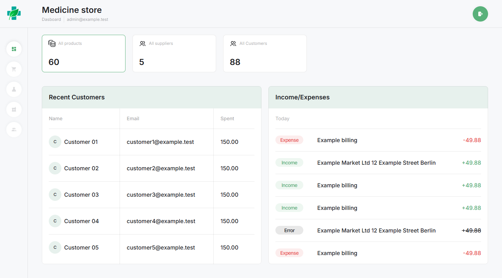
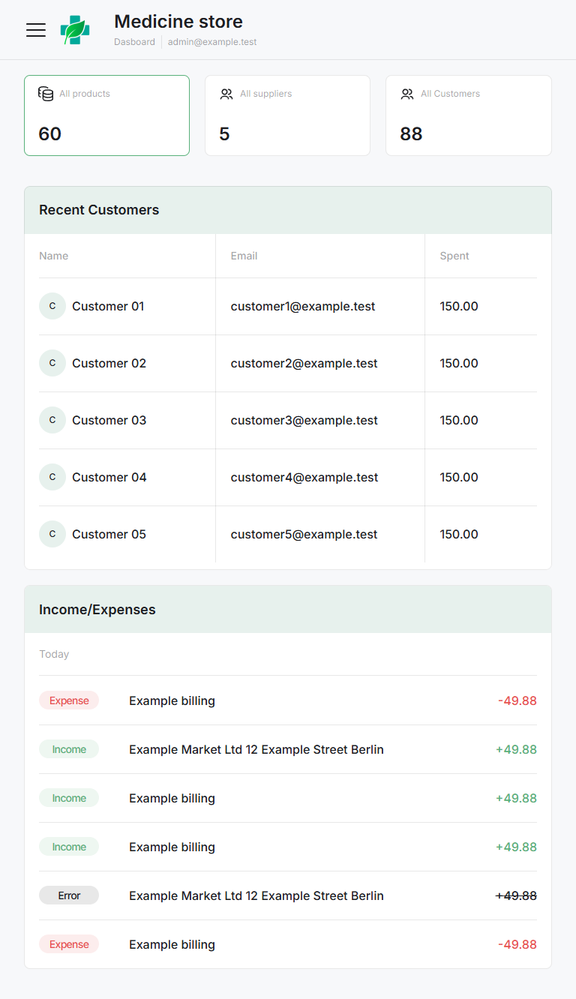
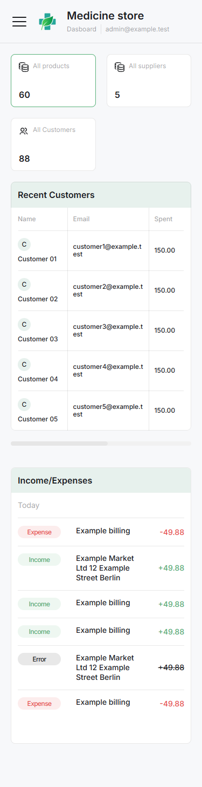

<div align="center">

# E-Pharmacy

### A responsive administration dashboard for a pharmacy system

[](https://react.dev/)
[](https://www.typescriptlang.org/)
[](https://vite.dev/)
[](https://playwright.dev/)

[Deutsch](README.md) · [Українська](README.uk.md) · [English](README.en.md)

[Frontend](https://github.com/AvalianY/admin_dashboard_front) · [Backend](https://github.com/AvalianY/admin_dashboard_back) · [Swagger](https://e-pharmacy-api-kz62.onrender.com/api-docs/)

</div>

## Table of Contents

- [About the Project](#about-the-project)
- [Features](#features)
- [Responsive Design](#responsive-design)
- [Technology Stack](#technology-stack)
- [Pages and Routes](#pages-and-routes)
- [Architecture](#architecture)
- [API Integration](#api-integration)
- [Demo Access](#demo-access)
- [Installation](#installation)
- [Environment Variables](#environment-variables)
- [Scripts](#scripts)
- [Testing](#testing)
- [Deployment](#deployment)
- [Author](#author)

## About the Project

**E-Pharmacy** is an administration dashboard for products, suppliers, customers and historical orders. The React application connects the approved Figma design to a protected REST API. Frontend and backend are two independent applications within one individually developed project.

## Features

- Login, protected routes, verified session restoration and logout
- Dashboard totals, separate last-30-day dialogs, recent customers and confirmed daily financial records
- Products: admin creation, editing and confirmed logical deletion
- Suppliers: admin creation/editing, exact monetary values and preserved historical BDT data
- Customers: creation, profile editing, details and confirmed history
- Read-only historical orders
- Name search, filtering, supported sorting and pagination with five records per page
- Shared React Hook Form/Yup forms with loading, error, empty and conflict states
- Responsive navigation, SVG sprite, local Inter font and keyboard-accessible native dialogs
- Server-protected demo reading; direct API requests cannot bypass write restrictions

## Responsive Design

Mobile First: fluid at 320–375 px; a centered maximum 375 px container at 376–767 px. Tablet starts at 768 px and retains a maximum 768 px container through 1439 px. Desktop starts at 1440 px: centered maximum 1440 px shell, 80 px Sidebar and 1280 px content. Narrow tables scroll within their panels; Desktop shows every intended column.

Actual application screenshots with synthetic test data; no production contact information or credentials.

<details>
<summary>View screenshots</summary>

### Desktop



### Tablet



### Mobile



</details>

## Technology Stack

| Technology | Version | Purpose |
| --- | --- | --- |
| [React](https://react.dev/) | 19.3.1 | User interface |
| [TypeScript](https://www.typescriptlang.org/) | 6.0.3 | Static types |
| [Vite](https://vite.dev/) | 8.3.8 | Development and build |
| [React Router](https://reactrouter.com/) | 8.5.1 | Routing and route protection |
| [React Hook Form](https://react-hook-form.com/) | 7.92.0 | Form state |
| [Yup](https://github.com/jquense/yup) | 1.7.1 | Form validation |
| [Vitest](https://vitest.dev/) | 5.1.0 | Unit tests |
| [Playwright](https://playwright.dev/) | 1.65.1 | Browser tests |

CSS Modules and Fetch API are built-in tools without separate npm package versions.

## Pages and Routes

| Route | Purpose |
| --- | --- |
| `/login` | Login, validation and password visibility |
| `/dashboard` | Metrics, period dialogs and current data |
| `/orders` | Historical orders, search and sorting |
| `/products` | Product catalog and admin CRUD |
| `/suppliers` | Suppliers and admin editing |
| `/customers` | Server pagination, customer profiles and history |

`/` → Login / Dashboard; `/home`, `/dasboard` → `/dashboard`.

## Architecture

Shared components and CSS Modules serve all three layouts. There is no additional state library or UI framework. Obsolete reads are aborted; writes are never automatically retried. Successful mutations reload the affected lists.

```text
src/
├── app/          # AuthProvider, routing, Layout
├── components/   # DataTable, forms, dialogs, controls
├── pages/        # Login, Dashboard, Records
├── hooks/        # useResource
├── services/     # API, session, validation, payloads
├── styles/       # Global styles
├── types/        # API DTOs
└── utils/        # Formatting
public/           # Fonts, images, icons.svg
tests/            # Unit and browser tests
```

## API Integration

[Backend](https://github.com/AvalianY/admin_dashboard_back) · [Live API](https://e-pharmacy-api-kz62.onrender.com) · [Swagger / OpenAPI](https://e-pharmacy-api-kz62.onrender.com/api-docs/)

The application uses relative `/api` URLs. Vite forwards local development/preview requests through a restricted proxy to the existing HTTPS API. Bearer tokens come only from Login, remain in `sessionStorage` and are verified through `user-info` after reload. Passwords are not persisted; 401, expiry and Logout clear the session. The server-verified role controls UI capabilities. Unconfigured users receive no edit permissions.

Money remains an exact decimal string. There is no BDT/EUR conversion, invented date or artificial customer/order relationship. Suppliers Amount shows only a number: current amount, otherwise legacy amount, otherwise —. This fallback changes neither the EUR edit field nor nullable PUT behavior. Only the approved last-30-day dialogs display unknown product/supplier metrics as 0; API values remain intact.

## Demo Access

The `demo` role uses the same Login and session mechanism as `admin`. It can access Dashboard, lists, search, filters, sorting, pagination, customer details/history and Logout. Add/Edit/Delete controls are disabled. The backend also denies all seven business mutations with `403 DEMO_READ_ONLY`; rejected CORS origins have a different error code.

**Public demo access is not active yet.** The protected server must be separately deployed and verified before secure account initialization. No demo password is shipped or published. See the [demo runbook](https://github.com/AvalianY/admin_dashboard_back/blob/main/docs/demo-access.md).

## Installation

Requirements: Node.js 26.13.x (package range >=26 <27), npm and Google Chrome for browser tests. No password is included. Actual local login requires authorized credentials for the configured backend.

```sh
git clone https://github.com/AvalianY/admin_dashboard_front.git
cd admin_dashboard_front
npm ci
npm run dev
```

[http://127.0.0.1:5173](http://127.0.0.1:5173)

## Environment Variables

The only frontend variable is `VITE_API_BASE_URL=/api` (the default). `.env.example` contains this non-secret example; a local `.env` is optional. The current client accepts only `/api`. Never put MongoDB URI, JWT signing keys or passwords in Vite variables or browser builds.

```env
VITE_API_BASE_URL=/api
```

## Scripts

| Command | Purpose |
| --- | --- |
| `npm run dev` | Loopback development server |
| `npm run typecheck` | Check TypeScript |
| `npm run lint` | Run ESLint |
| `npm run test` | Run unit tests |
| `npm run test:e2e` | Playwright with synthetic API |
| `npm run build` | Production build to dist/ |
| `npm run preview` | Inspect the built client locally |
| `npm run check` | TypeScript, ESLint, unit tests and build |

## Testing

```sh
npm run check
npm run test:e2e
npm audit
```

Current local results: TypeScript PASS, ESLint PASS, 39 unit tests PASS, 100 browser tests PASS, production build PASS; npm audit: 0 vulnerabilities. Browser tests cover admin/demo permissions, normal Login, session restoration, CRUD contracts with synthetic responses, errors, keyboard interaction and all layouts. These tests do not mutate production data.

Approved Mobile/Tablet/Desktop layouts remain the baseline. Final regression is documented in [demo validation](docs/demo-validation.md); [Desktop measurements](docs/desktop-design.md) and [asset optimization](docs/assets.md) remain separately available.

## Deployment

The frontend currently has **no confirmed public URL**. Production configuration is prepared in [vercel.json](vercel.json): HTTPS `/api` forwarding to the existing Render backend, React Router SPA fallback and disabled API caching. The caller's Bearer Authorization is forwarded; no secret is embedded in the frontend. The approved design is unchanged.

The owner deploys manually: Vercel **Vite**, Node.js **26.x**, repository root `./`, install `npm ci`, build `npm run build`, output `dist`. No environment variable is required; optional public `VITE_API_BASE_URL=/api`. Never copy backend secrets into frontend variables. Follow the [deployment and verification guide](docs/production-deployment.md). Any required backend CORS adjustment uses only the actual confirmed production origin, without guessed domains or `*`. Live proxy/authentication checks and Demo User activation follow the owner's deployment; they are not claimed complete by Git publication.

## Author

An individual project by [AvalianY](https://github.com/AvalianY).
