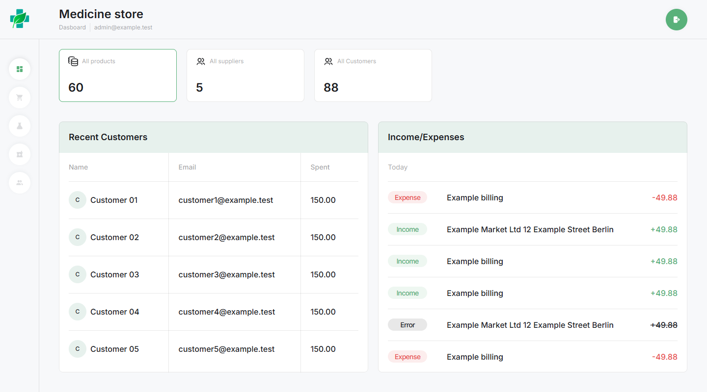
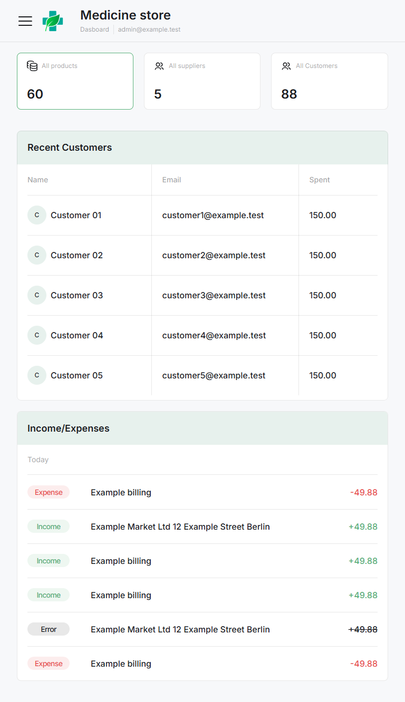
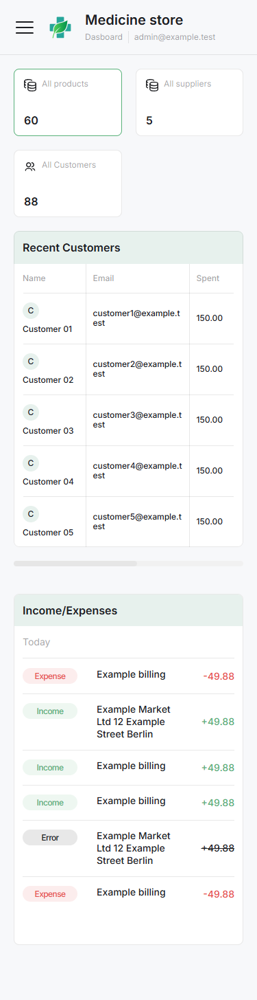

<div align="center">

# E-Pharmacy

### Eine responsive Administrationsoberfläche für ein Apothekensystem

[](https://react.dev/)
[](https://www.typescriptlang.org/)
[](https://vite.dev/)
[](https://playwright.dev/)

[Deutsch](README.md) · [Українська](README.uk.md) · [English](README.en.md)

[Frontend](https://github.com/AvalianY/admin_dashboard_front) · [Backend](https://github.com/AvalianY/admin_dashboard_back) · [Swagger](https://e-pharmacy-api-kz62.onrender.com/api-docs/)

</div>

## Inhaltsverzeichnis

- [Über das Projekt](#über-das-projekt)
- [Funktionen](#funktionen)
- [Responsive Design](#responsive-design)
- [Technologien](#technologien)
- [Seiten und Routen](#seiten-und-routen)
- [Architektur](#architektur)
- [API-Integration](#api-integration)
- [Demo-Zugang](#demo-zugang)
- [Installation und Start](#installation-und-start)
- [Umgebungsvariablen](#umgebungsvariablen)
- [Verfügbare Skripte](#verfügbare-skripte)
- [Tests und Qualität](#tests-und-qualität)
- [Deployment](#deployment)
- [Autor](#autor)

## Über das Projekt

**E-Pharmacy** ist ein administratives Dashboard für Produkte, Lieferanten, Kunden und historische Bestellungen. Die React-Anwendung verbindet das freigegebene Figma-Design mit einer geschützten REST API. Frontend und Backend sind zwei eigenständige Anwendungen desselben individuell entwickelten Projekts.

## Funktionen

- Anmeldung, geschützte Routen, Wiederherstellung einer geprüften Session und Logout
- Dashboard mit Gesamtzählern, getrennten 30-Tage-Dialogen, letzten Kunden und bestätigten Tagesfinanzen
- Produktkatalog: Erstellen, Bearbeiten und bestätigtes logisches Löschen für Admin
- Lieferanten: Erstellen/Bearbeiten; exakte Geldwerte und unveränderte historische BDT-Daten
- Kunden: Erstellen, Profilbearbeitung, Detailansicht und bestätigte Historie
- Historische Bestellungen mit ausschließlich lesendem Zugriff
- Namenssuche, Filterung, unterstützte Sortierung und Pagination mit fünf Datensätzen
- Gemeinsame Formulare mit React Hook Form/Yup, Lade-, Fehler-, Leer- und Konfliktzuständen
- Responsive Navigation, SVG-Sprite, lokale Inter-Schrift und tastaturbedienbare native Dialoge
- Serverseitig geschützter Demo-Lesezugriff; Änderungen sind auch bei direkten API-Aufrufen gesperrt

## Responsive Design

Mobile First: 320–375 px flexibel; 376–767 px zentrierter Container mit maximal 375 px. Tablet beginnt bei 768 px und bleibt bis 1439 px auf maximal 768 px begrenzt. Desktop beginnt bei 1440 px: zentrierter Container mit maximal 1440 px, Sidebar 80 px und Inhaltsbereich 1280 px. Tabellen scrollen auf kleineren Viewports innerhalb ihrer Panels; Desktop zeigt alle vorgesehenen Spalten.

Anwendungsscreenshots mit ausdrücklich synthetischen Testdaten; keine Produktionskontaktdaten oder Zugangsdaten.

<details>
<summary>Screenshots anzeigen</summary>

### Desktop



### Tablet



### Mobile



</details>

## Technologien

| Technologie | Version | Verwendung |
| --- | --- | --- |
| [React](https://react.dev/) | 19.3.1 | Benutzeroberfläche |
| [TypeScript](https://www.typescriptlang.org/) | 6.0.3 | Statische Typen |
| [Vite](https://vite.dev/) | 8.3.8 | Entwicklung und Build |
| [React Router](https://reactrouter.com/) | 8.5.1 | Routing und Routenschutz |
| [React Hook Form](https://react-hook-form.com/) | 7.92.0 | Formularzustand |
| [Yup](https://github.com/jquense/yup) | 1.7.1 | Formularvalidierung |
| [Vitest](https://vitest.dev/) | 5.1.0 | Unit-Tests |
| [Playwright](https://playwright.dev/) | 1.65.1 | Browser-Tests |

CSS Modules und Fetch API sind integrierte Werkzeuge und haben keine separate Paketversion.

## Seiten und Routen

| Route | Aufgabe |
| --- | --- |
| `/login` | Login, Validierung und Passwort-Sichtbarkeit |
| `/dashboard` | Kennzahlen, Zeitraum-Dialoge und aktuelle Daten |
| `/orders` | Historische Bestellungen, Suche und Sortierung |
| `/products` | Produktkatalog und Admin-CRUD |
| `/suppliers` | Lieferanten und Admin-Bearbeitung |
| `/customers` | Serverseitige Pagination, Kundenprofile und Historie |

`/` → Login / Dashboard; `/home`, `/dasboard` → `/dashboard`.

## Architektur

Gemeinsame Komponenten und CSS Modules bedienen alle drei Layouts. Es gibt keine zusätzliche State-Bibliothek oder UI-Suite. Abgebrochene Leseanfragen werden verworfen; Schreibanfragen werden nicht automatisch wiederholt. Erfolgreiche Änderungen laden die betroffenen Listen neu.

```text
src/
├── app/          # AuthProvider, routing, Layout
├── components/   # DataTable, forms, dialogs, controls
├── pages/        # Login, Dashboard, Records
├── hooks/        # useResource
├── services/     # API, session, validation, payloads
├── styles/       # Global styles
├── types/        # API DTOs
└── utils/        # Formatting
public/           # Fonts, images, icons.svg
tests/            # Unit and browser tests
```

## API-Integration

[Backend](https://github.com/AvalianY/admin_dashboard_back) · [Live API](https://e-pharmacy-api-kz62.onrender.com) · [Swagger / OpenAPI](https://e-pharmacy-api-kz62.onrender.com/api-docs/)

Die Anwendung verwendet relative `/api`-URLs. Vite leitet lokale Entwicklungs-/Preview-Anfragen über einen begrenzten Proxy an die bestehende HTTPS-API weiter. Bearer Tokens kommen ausschließlich aus dem Login, bleiben in `sessionStorage` und werden nach Reload über `user-info` geprüft. Passwörter werden nicht gespeichert; 401, Ablauf und Logout entfernen die Session. Die serverseitig bestätigte Rolle steuert die Bedienmöglichkeiten. Ein unkonfigurierter Benutzer erhält keine Bearbeitungsrechte.

Geldwerte bleiben exakte Dezimalstrings. Kein BDT/EUR-Umrechnen und keine erfundenen Daten oder Kunden-/Bestellbeziehungen. Suppliers Amount zeigt nur die Zahl: aktueller Betrag, sonst historischer Betrag, sonst —. Dieser Fallback verändert weder das EUR-Formular noch nullable PUT. Nur in den freigegebenen 30-Tage-Dialogen werden unbekannte Produkt-/Lieferantenzahlen als 0 dargestellt; die API-Werte bleiben unverändert.

## Demo-Zugang

Die Rolle `demo` nutzt dasselbe Login und dieselbe Session-Verwaltung wie `admin`. Sie darf Dashboard, Listen, Suche, Filter, Sortierung, Pagination sowie Kundendetails/-historie verwenden und sich abmelden. Add/Edit/Delete sind deaktiviert. Alle sieben schreibenden Geschäftsvorgänge werden zusätzlich vom Backend mit `403 DEMO_READ_ONLY` abgelehnt; CORS-Ablehnung verwendet einen anderen Fehlercode.

**Der öffentliche Demo-Zugang ist noch nicht aktiviert.** Der geschützte Server muss erst gesondert ausgerollt und geprüft werden; anschließend darf das Konto sicher initialisiert werden. Ein Demo-Passwort wird weder mitgeliefert noch veröffentlicht. Siehe den [Demo-Runbook](https://github.com/AvalianY/admin_dashboard_back/blob/main/docs/demo-access.md).

## Installation und Start

Voraussetzungen: Node.js 26.13.x (Paketgrenze >=26 <27), npm und für Browser-Tests Google Chrome. Das Repository enthält kein Passwort. Für echte lokale Anmeldung werden autorisierte Zugangsdaten des konfigurierten Backends benötigt.

```sh
git clone https://github.com/AvalianY/admin_dashboard_front.git
cd admin_dashboard_front
npm ci
npm run dev
```

[http://127.0.0.1:5173](http://127.0.0.1:5173)

## Umgebungsvariablen

Die einzige Frontend-Variable ist `VITE_API_BASE_URL=/api` (Standardwert). `.env.example` enthält dieses nicht geheime Beispiel; eine lokale `.env` ist optional. Der aktuelle Client akzeptiert ausschließlich `/api`. MongoDB URI, JWT-Schlüssel und Passwörter gehören niemals in Vite-Variablen oder den Browser-Build.

```env
VITE_API_BASE_URL=/api
```

## Verfügbare Skripte

| Befehl | Verwendung |
| --- | --- |
| `npm run dev` | Entwicklungsserver auf Loopback |
| `npm run typecheck` | TypeScript prüfen |
| `npm run lint` | ESLint ausführen |
| `npm run test` | Unit-Tests ausführen |
| `npm run test:e2e` | Playwright mit synthetischer API |
| `npm run build` | Produktions-Build nach dist/ |
| `npm run preview` | Gebauten Client lokal prüfen |
| `npm run check` | TypeScript, ESLint, Unit-Tests und Build |

## Tests und Qualität

```sh
npm run check
npm run test:e2e
npm audit
```

Aktuelle lokale Ergebnisse: TypeScript PASS, ESLint PASS, 39 Unit-Tests PASS, 100 Browser-Tests PASS, Production Build PASS; npm audit: 0 Sicherheitslücken. Browser-Tests prüfen Admin-/Demo-Rechte, normale Anmeldung, Session-Wiederherstellung, CRUD-Verträge mit synthetischen Antworten, Fehlerfälle, Tastaturbedienung und alle Layouts. Produktionsdaten werden durch diese Tests nicht verändert.

Die freigegebenen Mobile-/Tablet-/Desktop-Layouts bleiben die Grundlage. Die endgültige Regression ist in [der Demo-Validierung](docs/demo-validation.md) dokumentiert; [Desktop-Messwerte](docs/desktop-design.md) und [Ressourcenoptimierung](docs/assets.md) bleiben separat nachvollziehbar.

## Deployment

Das Frontend besitzt derzeit **keine bestätigte öffentliche URL**. Die Produktionskonfiguration steht in [vercel.json](vercel.json) bereit: HTTPS-Weiterleitung von `/api` zum bestehenden Render-Backend, SPA-Fallback für React Router und deaktiviertes API-Caching. Der Bearer-Authorization-Header des Aufrufers wird weitergeleitet; das Frontend enthält kein eingebettetes Geheimnis. Das freigegebene Design bleibt unverändert.

Der Eigentümer deployt manuell: Vercel **Vite**, Node.js **26.x**, Repository-Stamm `./`, Installation `npm ci`, Build `npm run build`, Ausgabe `dist`. Keine Umgebungsvariable ist erforderlich; optional öffentlich `VITE_API_BASE_URL=/api`. Backend-Geheimnisse dürfen nicht in Frontend-Variablen kopiert werden. Siehe [Deployment- und Prüfungsanleitung](docs/production-deployment.md). Eine erforderliche Backend-CORS-Anpassung verwendet ausschließlich das tatsächlich bestätigte Produktions-Origin, ohne erfundene Domains oder `*`. Live-Prüfungen von Proxy und Anmeldung sowie die Aktivierung des Demo User folgen erst nach dem Deployment durch den Eigentümer; eine Git-Veröffentlichung bestätigt deren Abschluss nicht.

## Autor

Individuelles Projekt von [AvalianY](https://github.com/AvalianY).
