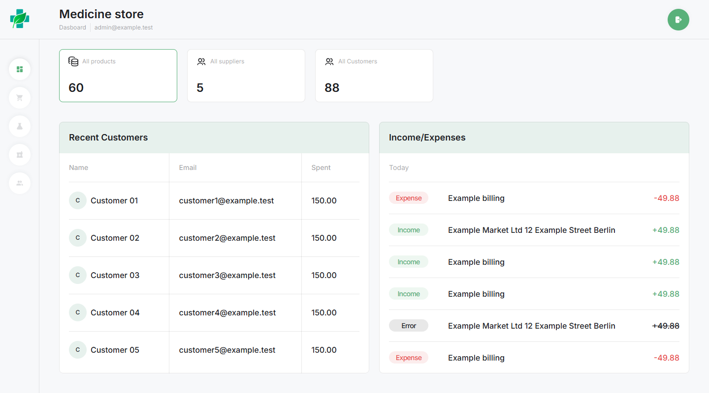
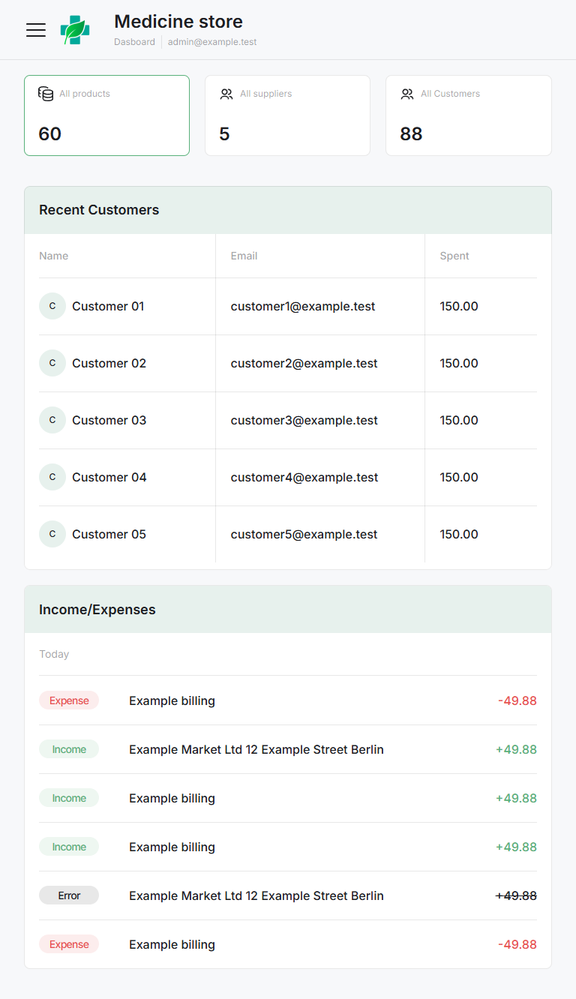
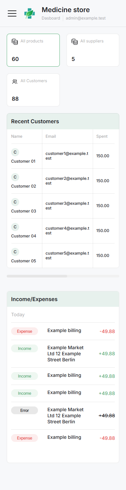

<div align="center">

# E-Pharmacy

### Адаптивна адміністративна панель аптечної системи

[](https://react.dev/)
[](https://www.typescriptlang.org/)
[](https://vite.dev/)
[](https://playwright.dev/)

[Deutsch](README.md) · [Українська](README.uk.md) · [English](README.en.md)

[Frontend](https://github.com/AvalianY/admin_dashboard_front) · [Backend](https://github.com/AvalianY/admin_dashboard_back) · [Swagger](https://e-pharmacy-api-kz62.onrender.com/api-docs/)

</div>

## Live Demo

**Live Application:** [E-Pharmacy](https://admin-dashboard-front-blush.vercel.app/)

| Поле | Значення |
| --- | --- |
| Demo Email | `demo@e-pharmacy.example` |
| Demo Password | `6800gJ8TaoEeM-ykTaehM4MWqY47ikFQX8gDiQPeFjg` |
| Role | `demo` |
| Access | Read-only |

Публічний демонстраційний доступ до погодженого навчального набору. Користувач може лише переглядати дані; створення, редагування та видалення блокує сервер. Наведені вище дані належать виключно demo-користувачу.

## Зміст

- [Live Demo](#live-demo)
- [Про проєкт](#про-проєкт)
- [Можливості](#можливості)
- [Адаптивний дизайн](#адаптивний-дизайн)
- [Технології](#технології)
- [Сторінки та маршрути](#сторінки-та-маршрути)
- [Архітектура](#архітектура)
- [Інтеграція з API](#інтеграція-з-api)
- [Демонстраційний доступ](#демонстраційний-доступ)
- [Встановлення та запуск](#встановлення-та-запуск)
- [Змінні середовища](#змінні-середовища)
- [Доступні скрипти](#доступні-скрипти)
- [Тестування та якість](#тестування-та-якість)
- [Розгортання](#розгортання)
- [Автор](#автор)

## Про проєкт

**E-Pharmacy** — адміністративна панель для роботи з товарами, постачальниками, клієнтами та історичними замовленнями. React-застосунок поєднує затверджений дизайн Figma із захищеним REST API. Frontend і backend — дві самостійні частини одного індивідуального проєкту.

## Можливості

- Вхід, захищені маршрути, відновлення перевіреної сесії та вихід
- Dashboard із загальними лічильниками, окремими діалогами за 30 днів, останніми клієнтами та підтвердженими фінансами за день
- Товари: створення, редагування та підтверджене логічне видалення для admin
- Постачальники: створення/редагування, точні грошові значення та незмінні історичні BDT-дані
- Клієнти: створення, редагування профілю, деталі та підтверджена історія
- Історичні замовлення лише для перегляду
- Пошук за назвою, фільтрація, підтримуване сортування та пагінація по п’ять записів
- Спільні форми React Hook Form/Yup, стани завантаження, помилки, порожні результати й конфлікти
- Адаптивна навігація, SVG-спрайт, локальний Inter і нативні діалоги з підтримкою клавіатури
- Захищений сервером демонстраційний перегляд; прямі API-запити також не можуть змінювати дані

## Адаптивний дизайн

Mobile First: гнучка композиція 320–375 px; у межах 376–767 px контейнер центрований і має максимум 375 px. Tablet починається з 768 px та до 1439 px зберігає максимальну ширину 768 px. Desktop починається з 1440 px: центрований контейнер максимум 1440 px, Sidebar 80 px і контент 1280 px. На менших екранах таблиці прокручуються всередині панелей; Desktop показує всі передбачені колонки.

Скриншоти реального інтерфейсу із синтетичними тестовими даними; без production-контактів або облікових даних.

<details>
<summary>Переглянути скриншоти</summary>

### Desktop



### Tablet



### Mobile



</details>

## Технології

| Технологія | Версія | Призначення |
| --- | --- | --- |
| [React](https://react.dev/) | 19.3.1 | Інтерфейс |
| [TypeScript](https://www.typescriptlang.org/) | 6.0.3 | Статичні типи |
| [Vite](https://vite.dev/) | 8.3.8 | Розробка та збирання |
| [React Router](https://reactrouter.com/) | 8.5.1 | Маршрутизація та захист сторінок |
| [React Hook Form](https://react-hook-form.com/) | 7.92.0 | Стан форм |
| [Yup](https://github.com/jquense/yup) | 1.7.1 | Валідація форм |
| [Vitest](https://vitest.dev/) | 5.1.0 | Unit-тести |
| [Playwright](https://playwright.dev/) | 1.65.1 | Браузерні тести |

CSS Modules і Fetch API — вбудовані інструменти без окремої версії npm-пакета.

## Сторінки та маршрути

| Маршрут | Призначення |
| --- | --- |
| `/login` | Вхід, валідація та показ пароля |
| `/dashboard` | Показники, діалоги періоду й актуальні дані |
| `/orders` | Історичні замовлення, пошук і сортування |
| `/products` | Каталог товарів та admin CRUD |
| `/suppliers` | Постачальники та редагування для admin |
| `/customers` | Серверна пагінація, профілі клієнтів та історія |

`/` → Login / Dashboard; `/home`, `/dasboard` → `/dashboard`.

## Архітектура

Спільні компоненти та CSS Modules обслуговують усі три композиції. Додаткових бібліотек стану або UI-наборів немає. Скасовані запити читання ігноруються; запити запису автоматично не повторюються. Після успішних змін відповідні списки завантажуються повторно.

```text
src/
├── app/          # AuthProvider, routing, Layout
├── components/   # DataTable, forms, dialogs, controls
├── pages/        # Login, Dashboard, Records
├── hooks/        # useResource
├── services/     # API, session, validation, payloads
├── styles/       # Global styles
├── types/        # API DTOs
└── utils/        # Formatting
public/           # Fonts, images, icons.svg
tests/            # Unit and browser tests
```

## Інтеграція з API

[Backend](https://github.com/AvalianY/admin_dashboard_back) · [Live API](https://e-pharmacy-api-kz62.onrender.com) · [Swagger / OpenAPI](https://e-pharmacy-api-kz62.onrender.com/api-docs/)

Застосунок використовує відносні адреси `/api`. Vite пересилає локальні development/preview-запити через обмежений proxy до наявного HTTPS API. Bearer-токен надходить лише з Login, зберігається в `sessionStorage` та після перезавантаження перевіряється через `user-info`. Паролі не зберігаються; 401, завершення строку дії та Logout очищують сесію. Можливості інтерфейсу визначає підтверджена сервером роль. Неналаштований користувач не отримує прав редагування.

Грошові значення залишаються точними десятковими рядками. Немає конвертації BDT/EUR, вигаданих дат або штучних зв’язків клієнтів із замовленнями. Suppliers Amount показує лише число: поточну суму, інакше історичну, інакше —. Цей fallback не змінює EUR-поле форми або nullable PUT. Лише в затверджених діалогах за 30 днів невідомі показники товарів/постачальників відображаються як 0; значення API зберігаються.

## Демонстраційний доступ

Публічний demo-доступ активовано. Використовуйте дані з блоку [Live Demo](#live-demo) у звичайній формі входу. Серверна роль `demo` дозволяє Dashboard, списки, пошук, фільтри, сортування, пагінацію, деталі клієнта та підтверджену історію. Add/Edit/Delete вимкнені; усі сім операцій зміни бізнес-даних додатково блокуються сервером із `403 DEMO_READ_ONLY`. Окремого механізму чи кнопки Demo Login немає.

Live-перевірка охоплює справжній вхід через Vercel, відновлення сесії, Logout та всі шість сторінок на Mobile, Tablet і Desktop. Публічний пароль призначений лише для цього обмеженого користувача. [Production-перевірка](https://github.com/AvalianY/admin_dashboard_back/blob/main/docs/production-activation.md).

## Встановлення та запуск

Потрібні Node.js 26.13.x (межа пакета >=26 <27), npm і Google Chrome для браузерних тестів. Дані публічного demo-користувача наведені вище; адміністративна розробка потребує власних дозволених облікових даних.

```sh
git clone https://github.com/AvalianY/admin_dashboard_front.git
cd admin_dashboard_front
npm ci
npm run dev
```

[http://127.0.0.1:5173](http://127.0.0.1:5173)

## Змінні середовища

Єдина frontend-змінна — `VITE_API_BASE_URL=/api` (типове значення). `.env.example` містить цей несекретний приклад; локальна `.env` необов’язкова. Поточний клієнт приймає лише `/api`. MongoDB URI, JWT-ключі та паролі не можна додавати до Vite-змінних або браузерної збірки.

```env
VITE_API_BASE_URL=/api
```

## Доступні скрипти

| Команда | Призначення |
| --- | --- |
| `npm run dev` | Development-сервер на loopback |
| `npm run typecheck` | Перевірка TypeScript |
| `npm run lint` | Запуск ESLint |
| `npm run test` | Запуск unit-тестів |
| `npm run test:e2e` | Playwright із синтетичним API |
| `npm run build` | Production-збірка до dist/ |
| `npm run preview` | Локальна перевірка зібраного клієнта |
| `npm run check` | TypeScript, ESLint, unit-тести та збирання |

## Тестування та якість

```sh
npm run check
npm run test:e2e
npm audit
```

Поточні локальні результати: TypeScript PASS, ESLint PASS, 39 unit-тестів PASS, 100 браузерних тестів PASS, production build PASS; npm audit: 0 вразливостей. Браузерні тести перевіряють права admin/demo, звичайний вхід, відновлення сесії, CRUD-контракти із синтетичними відповідями, помилки, клавіатуру та всі композиції. Ці тести не змінюють production-дані.

Затверджені Mobile/Tablet/Desktop залишаються основою. Підсумкова регресія описана в [перевірці demo](docs/demo-validation.md); [Desktop-виміри](docs/desktop-design.md) та [оптимізація ресурсів](docs/assets.md) доступні окремо.

**Production-перевірка 15.11.2026:** вхід admin/demo, всі дозволені GET, Vercel proxy/Bearer/no-store, сім безпечних перевірок `403 DEMO_READ_ONLY`, захист ролі від JWT/заголовків/query/frontend, сесії/Logout та справжній інтерфейс на Mobile/Tablet/Desktop — PASS. Усі 190 оригінальних документів залишилися BSON-ідентичними. Справжні адміністративні операції запису в production не виконувалися. [Обсяг перевірки](https://github.com/AvalianY/admin_dashboard_back/blob/main/docs/production-activation.md).

## Розгортання

[Live-застосунок](https://admin-dashboard-front-blush.vercel.app/) працює на Vercel Free, наявний API — на Render Free. [vercel.json](vercel.json) забезпечує HTTPS-пересилання `/api`, SPA fallback для React Router, збереження Bearer Authorization і вимкнене кешування API. Вхід, прямі переходи, перезавантаження, сесії та Logout перевірені зі справжнім API. Затверджений дизайн не змінено.

Власник розгортає застосунок вручну: Vite, Node.js 26.x, корінь репозиторію `./`, встановлення `npm ci`, збірка `npm run build`, результат `dist`. Змінні оточення не обов’язкові; необов’язкова публічна `VITE_API_BASE_URL=/api`. Секрети backend не переносяться у frontend-змінні. Render дозволяє підтверджений frontend-origin `https://admin-dashboard-front-blush.vercel.app` поряд з API-origin для Swagger. Git Auto-Deploy залишається вимкненим. [Інструкція deployment](docs/production-deployment.md).

## Автор

Індивідуальний проєкт [AvalianY](https://github.com/AvalianY).
